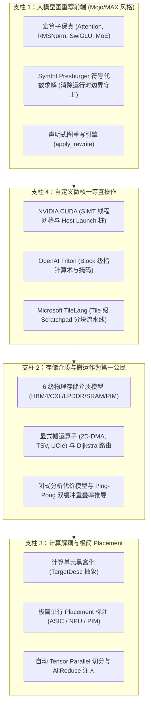
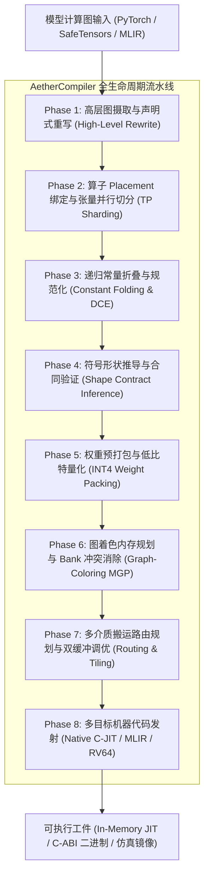
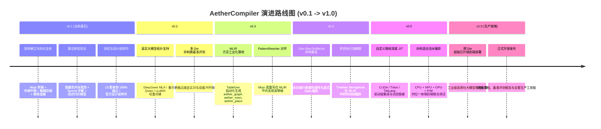

# AetherCompiler (以太编译器) 系统架构与设计说明书 (v0.1)

> **文档版本**：v0.1-Draft  
> **文档定位**：AetherCompiler 官方系统技术架构白皮书与设计说明书  
> **发布日期**：2026-11-24  
> **仓库地址**：[git@github.com:kaishaoshao/AetherCompiler.git](https://github.com/kaishaoshao/AetherCompiler)  
> **分支定位**：`main`（主分支核心设计规范）

---

## 目录
1. [一、 项目概述与设计哲学 (Executive Summary & Philosophy)](#一-项目概述与设计哲学-executive-summary--philosophy)
2. [二、 行业痛点与 AetherCompiler 的反向颠覆 (Industry Pain Points & Disruptions)](#二-行业痛点与-aethercompiler-的反向颠覆-industry-pain-points--disruptions)
3. [三、 四大核心架构支柱详细设计 (The Four Architectural Pillars)](#三-四大核心架构支柱详细设计-the-four-architectural-pillars)
   - [3.1 支柱 1：大模型高层图重写前端 (Mojo / MAX 风格)](#31-支柱-1大模型高层图重写前端-mojo--max-风格)
   - [3.2 支柱 2：存储介质与数据搬运作为第一公民的中端描述方法](#32-支柱-2存储介质与数据搬运作为第一公民的中端描述方法)
   - [3.3 支柱 3：计算架构解耦与极简算子执行位置绑定与切分 (Placement)](#33-支柱-3计算架构解耦与极简算子执行位置绑定与切分-placement)
   - [3.4 支柱 4：原生支持 CUDA、Triton、TileLang 自定义算子混编与一等互操作](#34-支柱-4原生支持-cudatritontilelang-自定义算子混编与一等互操作)
4. [四、 编译器全生命周期 Pass 流水线 (End-to-End Pass Pipeline)](#四-编译器全生命周期-pass-流水线-end-to-end-pass-pipeline)
5. [五、 异构超级芯片拓扑与多介质搬运路由模型 (Topology & Data Movement)](#五-异构超级芯片拓扑与多介质搬运路由模型-topology--data-movement)
6. [六、 双轨同构分支演进战略与工程规范 (Dual-Track Branch Strategy)](#六-双轨同构分支演进战略与工程规范-dual-track-branch-strategy)
7. [七、 项目演进路线图 (Milestones & Roadmap from v0.1 to v1.0)](#七-项目演进路线图-milestones--roadmap-from-v01-to-v10)

---

## 一、 项目概述与设计哲学 (Executive Summary & Philosophy)

### 1.1 什么是 AetherCompiler（以太编译器）？
**Aether（以太）**，在古典哲学与近代物理学假说中，被视作充斥空间、无所不在、承载一切电磁波动与能量传输的无形基本介质。

在进入大模型（Large Language Models, LLMs）与先进封装多 Die（Multi-Die / Chiplet）时代的今天，计算芯片的架构发生根本性剧变：
- 单颗芯片内不再是均质、连续的平坦内存，而是由 **3D-DRAM (HBM4)、CXL 3.0 内存池、主机 LPDDR5X、集群级共享 L2 SRAM、核心私有 Scratchpad 以及存算一体（PIM）近存 Bank** 共同构成的多层级物理存储金字塔。
- 芯片间通过 **TSV、UCIe、CXL 总线、NoC Crossbar** 形成复杂的异构互联拓扑。
- **系统的算力早已过剩，而跨介质的访存墙（Memory Wall）与数据搬运延迟（Movement Wall）成为限制吞吐与能效的绝对瓶颈。**

`AetherCompiler` 由此诞生。它不是对传统编译器的平庸模仿，而是**面向大模型异构多 Die 芯片与多级存储介质的全新一代 AI 全栈编译器**。数据如同波在“以太”中穿梭，计算随数据而在最适宜的介质中就地爆发。

### 1.2 核心公理与架构定位
AetherCompiler 确立如下第一性原理（First Principles）：
> **大模型结构保真于前端，存储介质与搬运显式于中端，硬件算力解耦于后端，顶级微核生态原生共生于全栈。**

---

## 二、 行业痛点与 AetherCompiler 的反向颠覆 (Industry Pain Points & Disruptions)

面对大模型与异构超节点芯片，业界主流编译器（IREE、TVM、Torch-MLIR、PyTorch Inductor）均存在深层局限，AetherCompiler 针对性提出四大颠覆性原则：

| 行业主流方案局限 | 业界传统做法与弊端 | AetherCompiler 的反向颠覆性原则 |
| :--- | :--- | :--- |
| **痛点 1：盲目早降阶 (Premature Lowering)** | **IREE / Torch-MLIR**：在计算图入口急于将复合算子（Attention、RMSNorm、SwiGLU）过早拆解为底层标量循环（`linalg.generic`）。宏观拓扑彻底破损，导致无法进行高层大模型重写（如 Paged Attention 替换、MoE 稀疏路由与动态 KV 缓存优化）。 | **前端语义保真与声明式重写**：严格保留 Attention、RMSNorm、SwiGLU、MoE Gating 等高层一等公民宏算子，提供类似 Mojo / MAX 的声明式图重写 API，并以 SymInt 符号推导消除运行时循环守卫。 |
| **痛点 2：单一平坦内存迷思 (Flat Memory Delusion)** | **TVM / 传统编译器**：默认硬件仅有单一平坦的 1D DRAM 地址空间。跨 Die、跨介质的数据搬移被隐式当作指针解引用，无视介质带宽与延迟的千倍差异。 | **存储介质与搬运一等公民化**：中端原生建模 6 级物理存储介质；数据搬运全部显式为拓扑路由算子，由 Dijkstra 引擎求解最优多跳路径并推导双缓冲重叠率。 |
| **痛点 3：指令集微架构硬编码耦合** | **专用 NPU 编译器**：优化 Pass 与指令集（如 x86 AVX、ARM SVE 或特定 RISC-V 协处理器）紧耦合，硬件微架构变动即导致编译器推倒重来。 | **计算架构正交解耦与极简 Placement**：将硬件执行单元抽象为可插拔黑盒；提供一行式 `placement` 语法，由编译器自动处理跨 Die 数据派发与张量并行（TP）切分。 |
| **痛点 4：手工核孤岛化与黑盒逃逸** | **多数全自动图编译器**：试图全自动生成一切代码，把人类专家精调的高性能算子视作破坏图优化的“黑盒逃逸”，导致外部核无法参与内存规约与流水线。 | **顶级微核原生混编一等互操作**：原生支持 NVIDIA CUDA、OpenAI Triton、Microsoft TileLang 自定义算子作为 DAG 一等节点，深度融入全局内存生命周期规约与 DMA Staging。 |

---

## 三、 四大核心架构支柱详细设计 (The Four Architectural Pillars)



### 3.1 支柱 1：大模型高层图重写前端 (Mojo / MAX 风格)

#### 3.1.1 大模型一等公民算子集 (Macro-Op Set)
前端拒绝将大模型复合逻辑压平为循环。原生定义并维持以下宏算子语义节点：
- **`FlashAttention(Q, K, V, mask, scale)`**：保持注意力高维张量结构，不展开为 QK 与 Softmax 循环。
- **`PagedAttention(Q, K_pool, V_pool, block_tables, context_lens)`**：表达基于页表的非连续 KV-Cache 访问。
- **`RMSNorm(x, weight, eps)`**：保留均方根层归一化。
- **`SwiGLU(x, w_gate, w_up)`**：保留门控线性单元复合结构 $\text{swish}(x \cdot W_{\text{gate}}) \times (x \cdot W_{\text{up}})$。
- **`RoPE(x, cos, sin)`**：旋转位置编码高维复数乘算子。
- **`MoERouter(x, gate_weights, top_k)`**：混合专家稀疏路由与负载均衡调度。

#### 3.1.2 符号 Presburger 代数约束求解器 (SymInt)
支持输入张量在序列长度 $S$、批次大小 $B$ 上的动态符号表达（`Dim('S')`）。
- **代数自化简**：恒等律折叠 $x + 0 \to x$、$x \times 1 \to x$；结合律常量折叠 $(S + 5) + 10 \to S + 15$；除余抵消 $(S \times 16) \pmod{16} \to 0$。
- **区间推导与整除性定理证明**：编译期求解约束条件，在进入切分循环前即可静态证明：
  $$\text{prove}(S \pmod{16} == 0) \implies \text{True}$$
  从而在代码生成阶段直接剔除所有的动态越界分支检查（Loop Guard Elimination）。

#### 3.1.3 声明式模式重写 API
```python
import aether
from aether.patterns import FlashAttentionPattern, SwiGLUPattern

# 构建大模型计算图
g = aether.Graph("DeepSeek_V3_Block")
# 声明式模式重写：一键匹配子图模式并高效替换
g.apply_rewrite(FlashAttentionPattern())
g.apply_rewrite(SwiGLUPattern())
```

---

### 3.2 支柱 2：存储介质与数据搬运作为第一公民的中端描述方法

#### 3.2.1 6 级异构物理存储介质模型
AetherCompiler 将内存划分为物理参数悬殊的 6 大层级：

| 存储介质标识 | 典型物理承载 | 典型容量 | 带宽 (Bytes/Cycle) | 延迟 (Cycles) | 拓扑角色 |
| :--- | :--- | :--- | :--- | :--- | :--- |
| **`3d_dram`** | HBM4 / 3D-Stacked DRAM | 32 ~ 64 GB | 1536 B/cyc | 12 cyc | 高带宽近核主存 |
| **`cxl_flash`** | CXL 3.0 PCIe 扩展介质 | 512 GB ~ 2 TB | 64 B/cyc | 80 cyc | 海量非易失权重/上下文池 |
| **`lpddr5x`** | 主机 Host 内存池 | 64 ~ 128 GB | 68 B/cyc | 24 cyc | 主控协调内存 |
| **`l2_sram`** | 片上集群共享 SRAM | 2 ~ 8 MB | 512 B/cyc | 4 cyc | 多核协作交换缓冲 |
| **`core_local_sram`** | 核心专用 Scratchpad | 64 ~ 128 KB | 1024 B/cyc | 1 cyc | 计算单元极速双缓冲片上内存 |
| **`pim_near_memory`** | 存算一体近存 Bank | 16 ~ 32 GB | 2048 B/cyc | 1 cyc | 近存就地计算颗粒 |

#### 3.2.2 显式数据搬运与 Dijkstra 多跳拓扑路由
跨存储层的数据流动不再是隐式指针，而是由显式 IR 节点描述：
- **`InterconnectLink` 物理建模**：TSV 直连、UCIe 高级封装互连、CXL.mem 总线、片上 Crossbar。
- **Dijkstra 多跳路由求解**：当数据位于 `cxl_flash` 而目标算子在 `core_local_sram` 计算时，编译器自动求解出传输成本最低的路径：
  $$\text{cxl\_flash} \xrightarrow{\text{CXL.mem}} \text{lpddr5x} \xrightarrow{\text{UCIe}} \text{l2\_sram} \xrightarrow{\text{Crossbar DMA}} \text{core\_local\_sram}$$
- **Ping-Pong 双缓冲计算与搬运重叠**：
  给定 GEMM 分块 $BM, BN, BK$，推导执行周期 $T_{\text{compute}}$ 与 DMA 搬运周期 $T_{\text{dma}}$：
  $$T_{\text{compute}} = \frac{2 \times BM \times BN \times BK}{\text{Compute\_Throughput}}, \quad T_{\text{dma}} = \frac{(BM \times BK + BK \times BN) \times \text{sizeof(dtype)}}{\text{Interconnect\_Bandwidth}}$$
  编译器自动调整分块规模使得 $T_{\text{dma}} \le T_{\text{compute}}$，保证传输开销被 100% 隐藏掩盖。

---

### 3.3 支柱 3：计算架构解耦与极简算子执行位置绑定与切分 (Placement)

#### 3.3.1 计算引擎黑盒化与 TargetDesc 抽象
编译器中端不对任何特定指令集（如 RISC-V Custom-0、x86 AVX、ARM SVE）做静态绑定。所有计算单元统一抽象为 `EngineDescriptor`：
- 计算能力标识（`MATRIX_CUBE`, `VECTOR_SIMD`, `ASIC_FIXED`, `PIM_ALU`）
- 向量宽度与张量脉动阵列维度（如 $16 \times 16 \times 4$）
- 支持的精度格式（`FP32`, `FP16`, `BF16`, `INT8`, `INT4`）

#### 3.3.2 极简单行 Placement 语法
开发者无需掌握复杂的分布式多设备异构调度器，仅需单行上下文标注：
```python
# 1. 精度敏感的 RMSNorm / Softmax 下沉至专用硬件 ASIC Die
with aether.placement("fixed_asic_die"):
    norm = ops.rmsnorm(x, w_norm, eps=1e-5)

# 2. 纯元素级残差 Add 绑定到存算一体近存 Bank 就地完成，零搬运延迟
with aether.placement("pim_near_memory_die"):
    res = ops.add(norm, residual_in)

# 3. 巨量 GEMM 绑定到张量脉动阵列，自动进行 Tensor Parallel 切分
with aether.placement("systolic_npu_die", tp_world_size=4):
    qkv = ops.matmul(res, w_qkv)
```

#### 3.3.3 自动化协同职责
1. **驻留介质对齐**：检查输入张量当前物理介质与目标计算核心的就近介质，跨 Die 时自动插入多跳 DMA 传输节点。
2. **张量并行自动切分**：对标记 `tp_world_size=N` 的线性层，自动对权重矩阵沿 Column（第一层）或 Row（第二层）切分，并在汇合点注入 `all_reduce` 算子。
3. **时间线信号量保护**：为跨 Die 执行序列自动注入 Timeline Semaphore 同步原语，保证跨引擎无竞态执行。

---

### 3.4 支柱 4：原生支持 CUDA、Triton、TileLang 自定义算子混编与一等互操作

#### 3.4.1 三大主流微核生态深度融合
AetherCompiler 将人类专家手写高性能算子视作第一公民：
- **NVIDIA CUDA**：支持嵌入 `__global__` 核与 host launch 桩，面向 GPU SM、Tensor Core 提供微观线程级并行。
- **OpenAI Triton**：以 Block 级指针算术与掩码（`tl.program_id`, `tl.arange`, `tl.load`, `tl.store`）表达复杂的分块融合操作（如 Fused Bias+GeLU）。
- **Microsoft TileLang**：以 Tile 级显式流水线（`T.alloc_tile`, `T.tile_load`, `T.tile_gemm`, `T.tile_store`）精确控制片上 Scratchpad 与数据搬运重叠。

#### 3.4.2 自定义算子的四大“第一公民”特权
1. **DAG 拓扑一等参与**：包装为 `CustomKernel` 并生成标准 `OpNode`，拥有确切的形状推导、类型合同和纯值依赖关系。
2. **穿透全局动态内存规划**：输入输出张量**完全纳入** Chaitin-Briggs 图着色内存规划器与生命周期分析，由编译器分配紧凑复用的物理偏移，保证 64 字节硬件对齐，杜绝内存碎片与非法重叠。
3. **介质感知与 DMA Staging 联动**：中端感知自定义算子所需的目标介质（如 SRAM Scratchpad 或 HBM），若输入数据驻留在远程介质（如 CXL），自动在其前驱和后继注入 2D-DMA 跨介质搬运。
4. **统一 C-ABI 与驱动级发射**：生成标准化的符号接口与异步时间线信号量保护，消除 Python 运行时开销。

---

## 四、 编译器全生命周期 Pass 流水线 (End-to-End Pass Pipeline)

AetherCompiler 组织了八阶段严密的编译流水线：



### 4.1 各阶段核心职责表

| 阶段 | Pass 名称 | 核心职责与产物 |
| :--- | :--- | :--- |
| **Phase 1** | `AetherGraphRewritePass` | 宏算子匹配与重写（FlashAttention, SwiGLU, PagedAttention 融合） |
| **Phase 2** | `PlacementAndTPPass` | 读取 `placement` 注解，完成 Multi-Die 派发与 Column/Row 矩阵切分 |
| **Phase 3** | `ConstantFoldingPass` | 全递归编译期常量子图求值与冻结，死代码消除（DCE） |
| **Phase 4** | `ShapeInferencePass` | SymInt 符号维度传播，静态合同约束校验与除余抵消证明 |
| **Phase 5** | `WeightQuantizationPass`| 权重 Group-wise INT4 打包量化（84.4% 内存压缩），生成反量化算子 |
| **Phase 6** | `GraphColoringMGPPass` | Chaitin-Briggs 冲突图着色，生命周期物理内存复用，保证 0 SRAM Bank 冲突 |
| **Phase 7** | `DataMovementRoutingPass` | Dijkstra 求解最优传输路径，推导分块闭式代价模型与双缓冲重叠率 |
| **Phase 8** | `MultiBackendEmitterPass`| 发射 Native C JIT 代码、MLIR 方言或 RV64 汇编，生成脱机执行包 |

---

## 五、 异构超级芯片拓扑与多介质搬运路由模型 (Topology & Data Movement)

### 5.1 典型超芯片物理拓扑抽象
```
[Host CPU Die] (LPDDR5X)
      │  UCIe-Link (68 GB/s)
      ▼
[Systolic NPU Die] ─── TSV-Direct (1.5 TB/s) ─── [HBM4 3D-DRAM Die]
      │  片上 Crossbar (1024 GB/s)
      ├── Core 0 SRAM Scratchpad (Ping-Pong Buffer)
      ├── Core 1 SRAM Scratchpad
      └── Cluster L2 Shared SRAM (4 MB)
      │
      │  CXL 3.0 Bus (64 GB/s)
      ▼
[CXL Expansion Flash Die] (512 GB)
      │
      ▼
[PIM Near-Memory Bank] (存算一体颗粒，近存总线直连)
```

### 5.2 闭式分析代价模型 (Closed-Form Analytical Cost Model)
为避免传统搜索型编译器（如 AutoTVM）长达数小时的低效搜索，AetherCompiler 建立闭式代价模型：
- 给定张量维度 $M, N, K$，核心 SRAM 容量限制 $C_{\text{sram}}$：
  $$\text{Constraint}: (BM \times BK + BK \times BN + BM \times BN) \times \text{sizeof(dtype)} \le C_{\text{sram}} / 2 \quad (\text{双缓冲约束})$$
- 求解使搬运周期与计算周期达到平衡的最优分块三元组 $(BM^*, BN^*, BK^*)$：
  $$(BM^*, BN^*, BK^*) = \arg\min_{(BM, BN, BK)} \max(T_{\text{compute}}, T_{\text{dma}})$$
  中端解析优化器在毫秒级内完成解析求解并输出确定性分块调度方案。

---

## 六、 双轨同构分支演进战略与工程规范 (Dual-Track Branch Strategy)

AetherCompiler 采取双轨同构并行推进策略：

### 6.1 分支分工矩阵

| 分支名 | 基础设施 | 角色定位 | 交付目标 |
| :--- | :--- | :--- | :--- |
| **`main`** | 文档规范、核心规范 | 官方基准与发布主线 | 架构白皮书、设计规范、发版与稳定工件 |
| **`feat/learn`** | 纯 Python 3.10+ | 算法试验田与金标准基准 (Golden Reference) | 白盒可观测性、四大支柱原型算法、100% 测试覆盖与位精确验证 |
| **`feat/llvm-mlir`**| C++20 / upstream MLIR | 工业级 MLIR 生态重构 | 定制 MLIR 方言（`aether_graph`, `aether_mem`, `aether_place`）、TableGen、One-Shot Bufferization |

### 6.2 协同铁律
1. **先行验证原则**：任何新的编译优化算法、图重写规则或硬件抽象，必须先在 `feat/learn` 中用纯 Python 验证通过，并补充完备的单元测试。
2. **生态重塑原则**：`feat/llvm-mlir` 严格继承 `feat/learn` 的设计，使用 MLIR C++ TableGen/PassManager 基础设施进行工程化工业级实现，**绝不退化为 IREE 式的扁平降阶**。

---

## 七、 项目演进路线图 (Milestones & Roadmap from v0.1 to v1.0)



---

> **AetherCompiler 架构委员会**  
> *让大模型计算在以太般的物理介质中自如流淌。*
