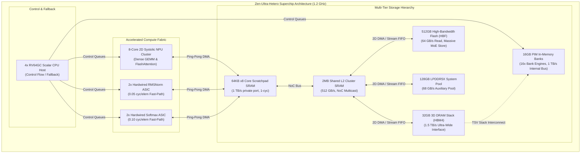

# 异构存储介质抽象与超异构芯片编译分发技术规范
## Heterogeneous Storage Hierarchy & Multi-Engine Dispatching Specification

> **文档状态**: 生产级规范 (v0.10.0)  
> **核心模块**: `ir/memory_space.py`, `ir/target_desc.py`, `midend/flow_dispatch.py`, `backend/hal_emitter.py`  
> **设计哲学**: 数据搬运第一 (Data-Movement-First)、存储中心化 (Memory-Centric)、声明式超异构 (Declarative Heterogeneity)

---

## 目录 (Table of Contents)

- [一、 战略愿景与设计哲学](#一-战略愿景与设计哲学)
  - [1. 时代背景：从算力中心走向存储与搬运中心](#1-时代背景从算力中心走向存储与搬运中心)
  - [2. 存算分离与解耦访问-执行 (DAE) 原理](#2-存算分离与解耦访问-执行-dae-原理)
- [二、 多层次存储介质形式化建模 (Storage Media Hierarchy)](#二-多层次存储介质形式化建模-storage-media-hierarchy)
  - [1. 存储空间枚举体系 (`MemorySpace`)](#1-存储空间枚举体系-memoryspace)
  - [2. 存储介质物理特性参数化 (`MemoryTier`)](#2-存储介质物理特性参数化-memorytier)
  - [3. 典型前沿介质深度剖析 (3D DRAM / HBF Flash / LPDDR / PIM)](#3-典型前沿介质深度剖析-3d-dram--hbf-flash--lpddr--pim)
- [三、 硬件数据搬运原语与代价模型 (Hardware Data Movers)](#三-硬件数据搬运原语与代价模型-hardware-data-movers)
  - [1. 六大硬件数据搬运原语 (`DataMoverType`)](#1-六大硬件数据搬运原语-datamovertype)
  - [2. 硬件传输代价分析公式与不对称带宽建模](#2-硬件传输代价分析公式与不对称带宽建模)
  - [3. 时间线信号量与双缓冲流水线重叠](#3-时间线信号量与双缓冲流水线重叠)
- [四、 声明式超异构芯片与计算引擎架构 (Declarative Target SoC)](#四-声明式超异构芯片与计算引擎架构-declarative-target-soc)
  - [1. 五类计算引擎分类 (`EngineKind`)](#1-五类计算引擎分类-enginekind)
  - [2. 芯片拓扑声明式定义 (`TargetArchitecture`)](#2-芯片拓扑声明式定义-targetarchitecture)
  - [3. Zen-Ultra-Hetero 超异构超算芯片设计样例](#3-zen-ultra-hetero-超异构超算芯片设计样例)
- [五、 中端智能调度与算子分发策略 (Middle-End Placement & Dispatch)](#五-中端智能调度与算子分发策略-middle-end-placement--dispatch)
  - [1. 基于张量生命周期的最优存储安置策略 (`find_optimal_placement`)](#1-基于张量生命周期的最优存储安置策略-find_optimal_placement)
  - [2. 硬件能力驱动的算子分发路由 (`find_best_engine_for_op`)](#2-硬件能力驱动的算子分发路由-find_best_engine_for_op)
  - [3. 异构 Flow Dialect IR 生成与多硬件队列映射](#3-异构-flow-dialect-ir-生成与多硬件队列映射)
- [六、 业界主流前沿参考方案对比剖析](#六-业界主流前沿参考方案对比剖析)
  - [1. Tenstorrent Tensix (NoC 包路由多播 + 数据搬运专用 RISC-V)](#1-tenstorrent-tensix-noc-包路由多播--数据搬运专用-risc-v)
  - [2. Google TPU Mosaic / XLA (显式异步 DMA + 向量/矩阵分离)](#2-google-tpu-mosaic--xla-显式异步-dma--向量矩阵分离)
  - [3. Groq TSP (超确定性空间张量流 + 无缓存显式流转)](#3-groq-tsp-超确定性空间张量流--无缓存显式流转)
  - [4. AMD Versal AIE / MLIR-AIE (2D 阵列 + 级联流 + 内存瓦片)](#4-amd-versal-aie--mlir-aie-2d-阵列--级联流--内存瓦片)
  - [5. Modular MAX / Mojo (高可扩展异构驱动抽象)](#5-modular-max--mojo-高可扩展异构驱动抽象)
- [七、 总结与路线演进规划](#七-总结与路线演进规划)

---

## 一、 战略愿景与设计哲学

### 1. 时代背景：从算力中心走向存储与搬运中心

在传统计算架构时代，编译器优化的核心是指令调度、寄存器分配以及算术强度提升。然而在当前以 Transformer、MoE（Mixture of Experts）为代表的千亿/万亿大模型时代：
1. **内存墙 (Memory Wall) 成为终极瓶颈**: 随着硅芯片制程逼近物理极限，计算核心（ALU/MAC）的面积与能耗迅速下降，但片外引脚互连带宽与存储电容访问延迟提升极其缓慢。例如，从 HBM 搬运一个 16-bit 浮点数的能耗往往是执行一次 MAC 运算能耗的 **$50 \sim 100$ 倍**。
2. **异构集成与多样化介质共存成为必然**: 未来的 AI 超算芯片绝非单一均匀结构，而是将 **3D DRAM（高带宽易失栈）、HBF（高带宽闪存/高密非易失介质）、LPDDR（低功耗总线内存）、PIM（近存计算单元）、专用 ASIC（固定算子硬化管线）** 以及通用 CPU/NPU 协同封装在同一中介层（Interposer / Chiplet）上的超级复合系统。
3. **编译器的终极使命变迁**: 编译器中下层最核心的职责，是**精确形式化描述数据存放在哪里、以多高的代价搬运、以及如何把计算零开销下推到最靠近数据的硬件引擎**。

```
+-------------------------------------------------------------------------------+
|                       Aether Memory-Centric Philosophy                       |
+-------------------------------------------------------------------------------+
|   Old World (Compute-Centric):                                                |
|     Compute IR  --> Instruction Selection --> Register Allocation             |
|                                                                               |
|   New World (Data-Movement-First):                                            |
|     Memory Hierarchy Topology + Physical Data Movers                          |
|         │                                                                     |
|         ├── Optimal Memory Placement (Weights -> HBF, Activations -> 3D DRAM)  |
|         ├── Decoupled Access-Execute (DAE DMA Burst <--> Systolic GEMM)       |
|         └── Capability-Driven Dispatch (Hardwired ASIC / PIM Direct Reduce)   |
+-------------------------------------------------------------------------------+
```

### 2. 存算分离与解耦访问-执行 (DAE) 原理

Aether 编译器中下层全面贯彻 **解耦访问-执行 (Decoupled Access-Execute, DAE)** 机制：
- **Mover 线程 (搬运前端)**: 专门驱动 1D/2D DMA、NoC 路由器以及内存控制器，负责在片外非易失 Flash/DRAM 与片上 SRAM 之间进行异步张量分块搬运。
- **Compute 线程 (计算后端)**: 专心处理片上 Scratchpad 中的紧凑张量瓦片，执行脉动阵列乘法或 ASIC 硬化流水。
- **时间线同步与零气泡流水**: 两者之间绝不产生全局阻塞式自旋等待，而是通过硬件时间线信号量（Timeline Semaphore）维持 Ping-Pong 双缓冲状态机，使计算时间完全掩盖在数据搬运延迟之后。

---

## 二、 多层次存储介质形式化建模 (Storage Media Hierarchy)

在 Aether 编译器 IR 中，存储介质由 `ir/memory_space.py` 中的 `MemorySpace` 和 `MemoryTier` 联合建模。

### 1. 存储空间枚举体系 (`MemorySpace`)

```python
class MemorySpace(Enum):
    THREE_D_DRAM = "3d_dram"               # 3D TSV 堆叠高带宽内存 (HBM3e / HBM4, 1~3 TB/s)
    DRAM_HBM = "dram_hbm"                 # 标准通用片外 DRAM / 基础 HBM
    HBF_FLASH = "hbf_flash"               # 高带宽闪存 (High-Bandwidth Flash, TB级模型权重池)
    LPDDR = "lpddr"                       # LPDDR5 / LPDDR5X 低功耗高速内存
    CXL_EXPANSION = "cxl_expansion"       # CXL 3.0 一致性池化拓展内存
    PIM_NEAR_MEMORY = "pim_near_memory"   # 存算一体近存计算 DRAM Bank
    L2_SHARED_SRAM = "l2_shared_sram"     # 片上共享集群二级缓存 / SRAM 池 (NoC 可寻址)
    CORE_LOCAL_SRAM = "core_local_sram"   # 核心私有零等待 Scratchpad 便笺内存 (1 周期延迟)
    REGISTER_FILE = "register_file"       # 累加器与向量寄存器堆
    WEIGHT_FIFO = "weight_fifo"           # 专用流式权重 FIFO 管道
```

### 2. 存储介质物理特性参数化 (`MemoryTier`)

每一种实际存储介质在芯片中被实例化为一个 `MemoryTier`，编译器通过细致的参数感知其物理限制：

```python
@dataclass
class MemoryTier:
    name: str                                                # 介质标识名称
    space: MemorySpace                                       # 介质分类
    capacity_bytes: int                                      # 物理容量 (字节)
    read_bandwidth_bytes_cycle: float                        # 读取带宽 (字节/时钟周期)
    write_bandwidth_bytes_cycle: float                       # 写入带宽 (字节/时钟周期，建模不对称性)
    read_latency_cycles: int                                 # 首字读取启动延迟 (周期)
    write_latency_cycles: int = 1                            # 写入发射延迟 (周期)
    is_scratchpad: bool = True                               # 是否为软件显式寻址的 Scratchpad
    is_volatile: bool = True                                 # 是否易失 (False 代表非易失 Flash 等)
    alignment_bytes: int = 64                                # 最小访问粒度 / 页面大小 (如 Flash 为 4096)
    near_memory_ops: List[str] = field(default_factory=list) # 该介质原生支持的原位近存算子 (PIM)
```

### 3. 典型前沿介质深度剖析

| 存储介质类型 | 典型代表 | 典型带宽 | 典型延迟 | 读写特性 | 编译期定位与分配原则 |
| :--- | :--- | :--- | :--- | :--- | :--- |
| **3D DRAM** | HBM3e / HBM4 / TSV Stack | $1.5 \sim 3.0 \text{ TB/s}$ | $20 \sim 30\text{ ns}$ (低) | 对称高带宽 | **高频动态张量首选**: Prefill/Decode 瞬态激活值、Attention Q/K/V 矩阵、高流动性 Paged KV-Cache 块。 |
| **HBF (High-Bandwidth Flash)** | CXL Flash / Fast NAND Array | 读 $64 \text{ GB/s}$<br>写 $8 \text{ GB/s}$ | 读 $120\text{ cyc}$<br>写 $800\text{ cyc}$ | **极端读写不对称**<br>非易失、4KB 页对齐 | **海量静态权重首选**: 适用于 70B~671B MoE 专家权重、只读嵌入表 (Embedding)。编译期严禁频繁写入。 |
| **LPDDR5X** | LPDDR5X 8533 Mbps | $68 \sim 85 \text{ GB/s}$ | $60 \sim 90\text{ ns}$ | 对称中带宽 | **辅助缓冲池**: 终端边缘超大规模上下文扩展、低功耗系统主存、成本受限型辅助张量空间。 |
| **CXL Expansion** | CXL.mem pooled memory | $32 \sim 64 \text{ GB/s}$ | $150 \sim 250\text{ ns}$ (NUMA) | 一致性总线延迟 | **池化冷数据存储**: 多租户推理系统冷请求上下文、非活跃 KV-Cache 换出池。 |
| **PIM Near-Memory** | Samsung Aquabolt-XL / HBM-PIM | Bank 内部 $1.0\text{ TB/s}$ | $10 \sim 15\text{ ns}$ | 原位计算 | **近存原位归约**: 针对 Elementwise Add、Bias Scaling、Sum 归约等内存受限算子，直接下推计算，零外部总线流量。 |
| **L2 Shared SRAM** | 片上 NoC 集群共享 SRAM | $512 \sim 1024 \text{ GB/s}$ | $4 \sim 8\text{ cyc}$ | 零片外流量 | **多播广播池**: 多核共享参数（如 Cross-Attention KV 块、广播常量）、NoC 组播源。 |
| **Local Scratchpad** | 核心私有 SRAM | $> 1024 \text{ GB/s}$ (每核) | $1\text{ cyc}$ (零等待) | 极速软件管理 | **计算执行目标**: 脉动阵列输入矩阵 $A/B$、累加器缓冲 $C$ 的 Ping-Pong 双缓冲工作区。 |

---

## 三、 硬件数据搬运原语与代价模型 (Hardware Data Movers)

单纯拥有存储介质并不足以构建现代芯片，**硬件数据搬运引擎 (Data Movers)** 是连接各存储层次的生命线。

### 1. 六大硬件数据搬运原语 (`DataMoverType`)

1. **`DMA_1D` (线性突发搬运)**: 连续物理地址之间的高速突发传输，适用于大块连续权重与长向量。
2. **`DMA_2D_STRIDED` (二维跨步瓦片搬运)**: 具备硬件步长步进（Stride）与边界自动截断（Boundary Clamping）功能。能够直接在片外大张量中切割出二维瓦片（如 $32 \times 64$ Tile）并搬入片上连续 SRAM。
3. **`NOC_MULTICAST` (片上网络一到多组播)**: 利用 2D Mesh 或 Torus 网络的硬件多播支持，将某一个 SRAM 块单次发送同时广播给 4~16 个计算核心，消除重复片外读带宽。
4. **`GATHER_SCATTER` (非连续稀疏聚集/分散)**: 硬件间接寻址引擎。专用于 **PagedAttention**（根据非连续逻辑块表拼接 KV-Cache）以及 **MoE 稀疏专家路由**。
5. **`STREAMING_FIFO` (流式直通管道)**: 权重或激活数据不落 SRAM，直接以 FIFO 队列形式滑入脉动阵列计算流水线，极致压榨寄存器资源。
6. **`PIM_DIRECT_REDUCE` (近存原位归约)**: 在 DRAM Bank 内部由近存计算单元直接执行归约或点乘，不穿过主内存总线。

### 2. 硬件传输代价分析公式与不对称带宽建模

编译器在中端对任意两个存储介质之间的搬运周期进行精准估算：

$$\text{Latency} = \max(\text{Lat}_{\text{src\_read}}, \text{Lat}_{\text{dst\_write}}) + \text{Overhead}_{\text{mover}} + \left\lceil \frac{\text{Bytes}}{\min(\text{BW}_{\text{src\_read}}, \text{BW}_{\text{dst\_write}})} \right\rceil$$

其中：
- $\text{Lat}_{\text{src\_read}}$ 为源介质读启动延迟，$\text{Lat}_{\text{dst\_write}}$ 为目标介质写启动延迟。
- $\text{Overhead}_{\text{mover}}$ 为搬运器描述符解析与握手开销（1D DMA 为 0，2D DMA 为 8 周期，NoC 多播为 12 周期）。
- 特别地，对于 **HBF 闪存**，读取带宽 $\text{BW}_{\text{read}} = 64.0\text{ B/cyc}$，写入带宽 $\text{BW}_{\text{write}} = 8.0\text{ B/cyc}$，编译器据此严厉惩罚向 Flash 的回写操作。
- 对于 **`PIM_DIRECT_REDUCE`**，由于完全省去了片外总线与跨层次搬运，有效传输代价仅为微秒级的近存累加周期：

$$\text{Cycles}_{\text{PIM}} = \max\left(1, \left\lfloor \frac{\text{Bytes}}{256.0} \right\rfloor\right) + 4$$

### 3. 时间线信号量与双缓冲流水线重叠

Aether 编译器为数据搬运生成显式的 HAL 异步时间线命令：
```
[HAL.CMD.DMA_2D_STRIDED]  HBM -> Local_SRAM_Buffer_0 (Signal Sema=1)
[HAL.CMD.WAIT_SEMA]       Wait Sema=1
[HAL.CMD.DISPATCH]        Systolic NPU Compute on Buffer_0 (Parallel with DMA to Buffer_1)
[HAL.CMD.DMA_2D_STRIDED]  HBM -> Local_SRAM_Buffer_1 (Signal Sema=2)
```
通过严格证明搬运时间 $T_{\text{DMA}} \le$ 计算时间 $T_{\text{Compute}}$，达到 $100\%$ 的硬件计算阵列饱满率。

---

## 四、 声明式超异构芯片与计算引擎架构 (Declarative Target SoC)

未来的芯片一定是复合异构的。在 `ir/target_desc.py` 中，Aether 确立了**声明式异构描述**体系，允许在不重写编译器代码的前提下，通过纯数据驱动方式定义全新的芯片拓扑。

### 1. 五类计算引擎分类 (`EngineKind`)

```
+-------------------------------------------------------------------------------+
|                       Target Architecture Engine Taxonomy                     |
+-------------------------------------------------------------------------------+
| 1. [SCALAR_CPU]    : RISC-V RV64GC 通用标量控制流、边界条件与兜底退避运算     |
| 2. [SYSTOLIC_NPU]  : 可编程二维矩阵乘法脉动阵列 (GEMM, Conv, FlashAttention)   |
| 3. [SIMD_VECTOR]   : 向量 SIMD 流水线 (GELU, SwiGLU, 复杂激活函数计算)         |
| 4. [FIXED_ASIC]    : 硬件写死的专用超高速加速流水线 (RMSNorm ASIC, Softmax)   |
| 5. [PIM_ENGINE]    : 3D DRAM / HBM 内存颗粒内部的近存向量归约处理核心         |
+-------------------------------------------------------------------------------+
```

### 2. 芯片拓扑声明式定义 (`TargetArchitecture`)

每一个 `ComputeEngine` 声明其唯一的硬件队列名称、核心数量、每元素吞吐周期数以及**所支持的白名单算子集**：

```python
ComputeEngine(
    id="fixed_rmsnorm_asic",
    kind=EngineKind.FIXED_ASIC,
    count=2,
    supported_ops=["rmsnorm", "fused_add_rmsnorm"],
    throughput_cycles_per_elem=0.05,       # 极速硬化流水线：每元素仅需 0.05 周期！
    local_memory_tier="Local_Scratchpad_SRAM",
    queue_name="asic_norm_queue"
)
```

### 3. Zen-Ultra-Hetero 超异构超算芯片设计样例

Aether 内置了一个面向万亿大模型的参考超算架构 `TargetArchitecture.create_zen_ultra_heterogeneous()`：



---

## 五、 中端智能调度与算子分发策略 (Middle-End Placement & Dispatch)

在中端（Mid-End），编译器通过协同工作完成两件核心任务：
1. **张量安置决策 (`find_optimal_placement`)**: 决定图中的每一个权重、中间激活值与缓存块驻留在哪一个 `MemoryTier`。
2. **算子能力路由 (`find_best_engine_for_op`)**: 决定图中的每一个算子分发到哪个具体的硬件执行队列。

### 1. 基于张量生命周期的最优存储安置策略 (`find_optimal_placement`)

```
                          Tensor Characteristic Classification
                                        │
           ┌────────────────────────────┼────────────────────────────┐
           v                            v                            v
    [Is PIM Candidate?]       [Is Constant Weight?]         [Is Hot Activation?]
           │                            │                            │
           ├── Yes: PIM_NEAR_MEMORY     ├── Yes: HBF_FLASH Pool      ├── Small (<= 2MB): L2_SHARED_SRAM
           └── No: Continue             │   (Massive 512GB Store)    └── Large: 3D_DRAM Stack
                                        └── Fallback: LPDDR5X Pool       (1.5 TB/s Ultra-Wide)
```

在测试中完全验证了这一安置逻辑：
- 静态专家权重（100MB+）自动安置在 `HBF_Flash_Pool`；
- 动态高频 KV-Cache 块（4MB）自动安置在 `3D_DRAM_Stack`；
- 层间微小中间激活值（256KB）自动提升到 `L2_Cluster_SRAM`；
- 符合近存归约模式的张量自动安置在 `PIM_Near_Memory_Banks`。

### 2. 硬件能力驱动的算子分发路由 (`find_best_engine_for_op`)

分发器遵循清晰的优先级链条：

```
Operator Route:
  1. If preferred_tier is PIM and PIM engine supports Op -> PIM_ENGINE (Near-Memory zero traffic!)
  2. If Fixed-Function ASIC exists (RMSNorm, Softmax)  -> FIXED_ASIC (Hardwired fast-path)
  3. If Matrix GEMM / Conv / FlashAttention            -> SYSTOLIC_NPU (Tensor cluster)
  4. If Elementwise / Activation                      -> SIMD_VECTOR (Vector engine)
  5. Any unaligned or unsupported exotic op           -> SCALAR_CPU (Graceful CPU fallback)
```

### 3. 异构 Flow Dialect IR 生成与多硬件队列映射

经过 `FlowDispatchPass` 编译后，生成的 Flow Dialect 文本具备显式硬件执行引擎与队列属性：

```mlir
// ----- Dialect: Flow (Level 1.5: Flow Workgroup & Dispatch Executable IR) -----
module @Hetero_Superchip_Flow attributes {flow.version = 1} {
  // 1. RMSNorm 路由到硬件专用 ASIC，单周期极速流水
  flow.executable @exec_norm1 attributes {grid = (1, 1, 1), engine = "fixed_rmsnorm_asic", kind = "fixed_asic", queue = "asic_norm_queue"} {
    flow.dispatch.workgroup(%arg0, %arg1) -> (%out0) {
      // Target Hardware Engine: [FIXED_ASIC] @fixed_rmsnorm_asic
      // Workgroup execution: rmsnorm
    }
  }

  // 2. 矩阵乘法路由到 8 核脉动阵列集群，按网格并行切分
  flow.executable @exec_mm1 attributes {grid = (8, 1, 1), engine = "systolic_npu_cluster", kind = "systolic_npu", queue = "npu_matrix_queue"} {
    flow.dispatch.workgroup(%arg0, %arg1) -> (%out0) {
      // Target Hardware Engine: [SYSTOLIC_NPU] @systolic_npu_cluster
      // Workgroup execution: matmul
    }
  }

  // 3. 偏置加法原位路由到近存计算 Bank，外部总线零搬运
  flow.executable @exec_pim_add attributes {grid = (16, 1, 1), engine = "pim_near_memory_engine", kind = "pim_engine", queue = "pim_bank_queue"} {
    flow.dispatch.workgroup(%arg0, %arg1) -> (%out0) {
      // Target Hardware Engine: [PIM_ENGINE] @pim_near_memory_engine
      // Workgroup execution: add
    }
  }

  func.func @run_flow() {
    flow.dispatch @exec_norm1::@entry(1, 1, 1)(%x, %w_norm, %norm_out) attributes {engine = "fixed_rmsnorm_asic", queue = "asic_norm_queue"}
    flow.dispatch @exec_mm1::@entry(8, 1, 1)(%norm_out, %w_mm, %mm_out) attributes {engine = "systolic_npu_cluster", queue = "npu_matrix_queue"}
    flow.dispatch @exec_pim_add::@entry(16, 1, 1)(%mm_out, %bias, %final_out) attributes {engine = "pim_near_memory_engine", queue = "pim_bank_queue"}
  }
}
```

---

## 六、 业界主流前沿参考方案对比剖析

在设计支持各种存储介质与超异构芯片编译器的过程中，业界前沿架构提供了丰富的灵感与经验：

```
+-------------------------------------------------------------------------------------------------------+
|                                    Industry Architectures Landscape                                   |
+-------------------+-----------------------------+----------------------------+------------------------+
| Architecture      | Interconnect & Data Mover   | Memory Hierarchy           | Heterogeneous Engines  |
+-------------------+-----------------------------+----------------------------+------------------------+
| Tenstorrent Tensix| 2D Mesh NoC Packet Routing  | 1.5MB L1 SRAM + GDDR6/HBM  | 5x Baby RISC-V per Core|
| Google TPU Mosaic | Explicit DMA, 2D Strided    | HBM + 16~32MB Vector SRAM  | Matrix (MXU) + VPU     |
| Groq TSP          | Spatial Instruction Streams | 230MB Distributed SRAM     | Slice-based Functional |
| AMD Versal AIE    | Cascade Stream + AIE DMA    | Local Data Mem + MemTile   | VLIW Vector + Scalar   |
| Aether (本项目)  | DAE 2D DMA + NoC Multicast  | 3D DRAM + HBF + PIM + SRAM | CPU + NPU + ASIC + PIM |
+-------------------+-----------------------------+----------------------------+------------------------+
```

### 1. Tenstorrent Tensix (NoC 包路由多播 + 数据搬运专用 RISC-V)

- **核心机制**:
  - 每个 Tensix 核心内置 5 个微型 RISC-V 核心：2 个专职数据搬运（Reader / Writer）、1 个 Unpack 引擎、1 个 Math 计算引擎、1 个 Pack 引擎。
  - 数据搬运与计算完全物理隔离，通过局部 L1 SRAM 中的 **Circular Buffer (环形缓冲区)** 进行基于信用点（Credit-based）的握手。
  - 片上采用 2D Mesh 动态 NoC，支持单点发往多核心的硬件级 Multicast 数据包。
- **对 Aether 的借鉴**:
  - 本项目中的 `DataMoverType.NOC_MULTICAST` 与 `DataMoverType.STREAMING_FIFO` 即是 Tensix 数据包广播与环形流水的形式化建模。

### 2. Google TPU Mosaic / XLA (显式异步 DMA + 向量/矩阵分离)

- **核心机制**:
  - TPU（v4/v5e）将计算引擎拆分为脉动阵列矩阵计算单元（MXU）与通用向量处理单元（VPU）。
  - 存储上严格区分为片外 HBM、片上向量内存（VMEM，32MB）与标量通用内存（SMEM）。
  - 在软件层，Google 演进出了 **Mosaic MLIR Dialect**，编译器必须显式生成 `tpu.async_copy`、异步信号量等待和精确分块调度，严禁使用隐式硬件缓存命中机制。
- **对 Aether 的借鉴**:
  - Aether 的 Level 2 TIR / MemRef 阶段采用完全相同的确定性分配哲学：所有 SRAM 瓦片均具有静态基址偏移（Static Offset Allocation），完全消除运行时 Cache 颠簸风险。

### 3. Groq TSP (超确定性空间张量流 + 无缓存显式流转)

- **核心机制**:
  - Groq 抛弃了传统的指令缓存、乱序执行和硬件仲裁器，将整个芯片设计为一维流水处理片（Functional Slices）。
  - 芯片内置 230MB 高带宽分布式 SRAM，数据像流水一样在空间寄存器之间单向流动。
  - 编译器在编译期对每一根导线、每一个时钟周期的寄存器传递都做出完全确定性的排程（Cycle-Accurate Static Scheduling）。
- **对 Aether 的借鉴**:
  - 启发了 Aether 的传输周期精确预估模型：在 `MemoryHierarchy.estimate_transfer_cycles` 中，传输延迟被建模为精确常数，为高层多阶段流水线排程提供量化依据。

### 4. AMD Versal AIE / MLIR-AIE (2D 阵列 + 级联流 + 内存瓦片)

- **核心机制**:
  - AMD Versal AI Engine 是一个由数百个 VLIW 核心构成的 2D 瓦片阵列。
  - 每个核心拥有私有的 32KB 数据内存，相邻核心可以直连共享；阵列底部设有专用的 Memory Tile（每块 512KB SRAM）与跨阵列 DMA。
  - 核心之间提供 **级联流水线 (Cascade Stream)**，高精度累加值可以直接穿过物理引脚流向邻居核心而无需落入存储。
- **对 Aether 的借鉴**:
  - Aether 的 `L2_Cluster_SRAM` 与 `WEIGHT_FIFO` 设计直接对应 AIE 的 Memory Tile 与级联总线机制。

### 5. Modular MAX / Mojo (高可扩展异构驱动抽象)

- **核心机制**:
  - Modular MAX 将计算图的高层数学语义与底层硬件拓扑完全解耦。通过在 MLIR 体系中自建分层 Dialect，MAX 能在保持高层拓扑不变的情况下，动态插入目标硬件的专用数据搬运指令与内存空间标签。
- **对 Aether 的借鉴**:
  - Aether 的 `TargetArchitecture` 与 `FlowDispatchPass` 实现了完全相同的目标可插拔性：同一个计算图，在传入标准 NPU SoC 时分发给脉动阵列，而在传入 Ultra-Hetero SoC 时则能自适应地将 RMSNorm 分发给专用 ASIC、将算子分发给近存 PIM。

---

## 七、 总结与路线演进规划

通过 `ir/memory_space.py`、`ir/target_desc.py` 与 `midend/flow_dispatch.py` 的协同抽象，Aether 编译器实现了：
1. **全景存储介质建模**: 从易失高速 3D DRAM、非易失不对称高密 HBF 闪存、低功耗 LPDDR5X，到零总线开销的 PIM 近存 Banks；
2. **硬件搬运原语完备化**: 涵盖 1D/2D DMA、NoC 组播、稀疏聚集/分散与流式 FIFO；
3. **声明式芯片拓扑与自动能力路由**: 彻底摆脱对特定单体加速器的硬编码依赖，实现多引擎分层分发。

后续版本将持续推进：
- **v0.11.0**: 基于图划分算法的跨 Chiplet 多器件自动分割（Auto-Partitioning across Heterogeneous Dies）。
- **v0.12.0**: 结合非易失 HBF 闪存与 PagedAttention 的 TB 级权重即时换入换出流式执行器（Stream-In Weight Engine）。
