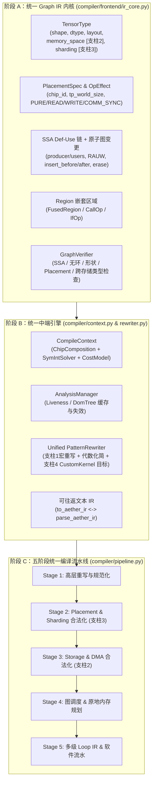

# 06 Aether Graph IR 统一架构规范 —— 四大支柱收敛为一套 IR 内核

> **核心目标**：消除 Pass 间靠无类型 `attrs` 字典和各自为战的遍历逻辑拼接造成的碎片化，将 AetherCompiler 的四大架构支柱（大模型高层重写、显式存储介质与搬运、极简 Placement 与切分、CUDA/Triton/TileLang 自定义核）收敛到同一套强类型、可校验、可缓存分析、可往返序列化的 **Aether Graph IR 内核**上。

---

## 一、统一架构总览



---

## 二、四大支柱如何成为 IR 的一等类型（而非散落字典）

### 1. 强类型张量与放置描述符 (`ir_core.py`)
- **`ShardingSpec(axis, world_size, rank)`**：描述张量在设备网格上的分片方式（`REPLICATED` / `SHARDED` / `PARTIAL_SUM`）。
- **`TensorType(shape, dtype, layout, memory_space, sharding)`**：把存储介质（支柱 2）和切分状态（支柱 3）写入张量类型本身。
- **`PlacementSpec(chip_id, tp_world_size, shard_dim, dispatch_hint)`**：`OpNode` 的一等强类型字段，由 `with placement(...)` 自动注入并同步。
- **`OpEffect`**（`PURE` / `READ` / `WRITE` / `ALLOC` / `FREE` / `COMM_SYNC`）：注册在 `OpDefinition` 上，使 DCE、调度器、重算与原地复用自动遵守有状态算子（如 `paged_kv_append`、`all_reduce`、`dma_transfer`）的顺序约束。

### 2. SSA Def-Use 链与安全图修改原语 (`Graph`)
- 每个 `Tensor` 维护 `producer: Optional[OpNode]` 与 `users: List[OpNode]`。
- `Graph` 提供原子变更 API：
  - `replace_all_uses_with(old_tensor, new_tensor)` (RAUW)
  - `insert_before(anchor, node)` / `insert_after(anchor, node)`
  - `erase_node(node)`（安全检查无活跃使用者后移除）
- **`GraphVerifier` (`graph.verify(...)`)**：校验 SSA 唯一性、无环、无悬空输入、算子形状契约、Def-Use 一致性、Placement 芯片合法性；开启 `strict_storage=True` 时，**跨存储介质直读会被直接判为类型不合法**，直到 Stage 3 插入显式 `dma_transfer` 使其合法化！

### 3. 嵌套 `Region` 与控制流
- `OpNode.regions: List[Region]` 让子图成为一等结构（不再把子图塞在 `attrs["sub_nodes"]` 字典里）。
- 内建支持：
  - **`call` (`CallOp`)**：把单个 Decoder Layer 封装成子 `Region`，主图复用调用 N 次而不展开 N 份重复节点。
  - **`cond` (`IfOp`)**：在单张图内表达动态条件分支（如 `S == 1` 走 Decode 分支 vs `S > 1` 走 Prefill 分支），并在 `VirtualNPUSimulator` 中完整执行。

### 4. 统一 `PatternRewriter` 与支柱 4 自定义核接入 (`compiler/rewriter.py`)
- 所有局部图重写（代数化简、支柱 1 的 `SwiGLU` / `FlashAttention` / `PagedKVAppend`、以及支柱 4 的 CUDA/Triton/TileLang `CustomKernel`）均实现统一的 `RewritePattern.match_and_rewrite(node, rewriter)`。
- `CustomKernel.as_rewrite_pattern(match_fn, benefit=...)` 允许自定义微核直接作为高优先级/低代价重写目标参与竞争，并完整继承 `OpEffect`、`PlacementSpec`、`TensorType` 和 `Graph.verify()`！

### 5. `CompileContext`、`AnalysisManager` 与 `AetherPipeline`
- `CompileContext` 统一承载 `ChipComposition`、`SymbolicConstraintSolver`、核数/SRAM 预算及 `AnalysisManager`。
- `AnalysisManager` 缓存 `LivenessAnalysis`、`DominatorTreeAnalysis`、`MemoryPressureAnalysis`，按图版本号（`graph.version`）自动失效重建。
- `AetherPipeline` 将五个阶段串成一条统一流水线，默认开启 `verify_after_each=True`，每个阶段结束后自动验证 IR 不变量；最终在 Stage 3 完成后满足 `strict_storage=True` 校验。

### 6. 完整可往返文本 IR (`to_aether_ir()` ↔ `parse_aether_ir()`)
- 完整序列化与反序列化四大支柱的一等类型与属性：
  ```text
  %h0: tensor<4x16xf32, layout=ROW_MAJOR, mem=NPU_Local_Scratchpad_SRAM, shard=REPLICATED> =
      aether.matmul(%x, %w) {placement="systolic_npu_die", tp_world_size=4}
  ```
- 支持任意编译阶段导出文本 IR、人工或工具检查后再无损解析回 `Graph` 对象继续编译。
