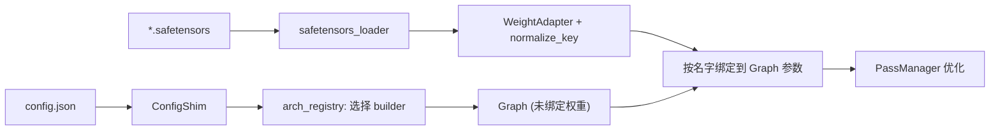

# 06 模型家族与权重格式 —— 模型如何进入编译器

> **编译器关注点**：编译器拿到的不是"论文里的模型"，而是 `config.json` + `*.safetensors`。  
> 不同家族的微小结构差异（bias、norm 位置、命名）决定了前端 Importer 和 WeightAdapter 怎么写。

---

## 1. 主流模型家族结构差异

| 特性 | LLaMA 2/3 | Qwen2/2.5 | DeepSeek-V2/V3 | Gemma 1/2 |
|------|-----------|-----------|----------------|-----------|
| Norm | RMSNorm (Pre) | RMSNorm (Pre) | RMSNorm (Pre) | RMSNorm (Pre + Post)，weight 用 `1+w` |
| Attention | GQA | GQA | **MLA** | MQA/GQA |
| QKV Bias | 无 | **有** | 无 | 无 |
| FFN | SwiGLU | SwiGLU | SwiGLU + **MoE** | **GeGLU** |
| 位置编码 | RoPE | RoPE (θ=1e6) | 解耦 RoPE（`qk_rope_head_dim`） | RoPE |
| Embedding 缩放 | 无 | 无 | 无 | `× sqrt(D)` |
| 权重共享 | 3: 否 | 小模型: 是 | 否 | 是 |

> **编译器视角**：这些差异都是**局部的**，不改变 Transformer 的骨架。  
> 因此前端设计应该是"一套骨架 + 家族差异插件"（Mojo/MAX 的 `arch_registry` 思路），而不是每个模型写一份图。

---

## 2. config.json 关键字段

```json
{
  "model_type": "qwen2",
  "hidden_size": 3584,              // D
  "intermediate_size": 18944,       // I（FFN 中间维度）
  "num_attention_heads": 28,        // H
  "num_key_value_heads": 4,         // G（GQA 分组数）
  "num_hidden_layers": 28,          // L
  "rms_norm_eps": 1e-6,
  "rope_theta": 1000000.0,
  "vocab_size": 152064,
  "max_position_embeddings": 32768,
  "tie_word_embeddings": false,
  "torch_dtype": "bfloat16"
}
```

DeepSeek 额外字段：`kv_lora_rank`, `q_lora_rank`, `qk_rope_head_dim`, `qk_nope_head_dim`, `v_head_dim`, `n_routed_experts`, `n_shared_experts`, `num_experts_per_tok`, `moe_intermediate_size`。

### 2.1 ConfigShim（AetherCompiler）

不同来源字段名不统一（`hidden_size` / `dim` / `n_embd`），`models/config_shims.py` 归一化为 `StandardModelConfig`：

```python
cfg = ConfigShim.from_dict(json.load(open("config.json")))
# cfg.dim, cfg.num_heads, cfg.intermediate_dim, cfg.is_moe, cfg.kv_lora_rank ...
```

---

## 3. SafeTensors 格式

```
┌──────────────┬─────────────────────────┬──────────────────────────┐
│ 8 字节 u64 LE │ JSON Header (N 字节)     │ 原始张量数据（连续）       │
│  = N         │ {"name": {dtype, shape,  │                          │
│              │   data_offsets:[a,b]}}   │                          │
└──────────────┴─────────────────────────┴──────────────────────────┘
```

优点：
- **零拷贝 mmap**：header 给出偏移，直接映射到内存
- **安全**：不像 pickle (`.bin`) 可以执行任意代码
- **分片**：大模型拆成 `model-00001-of-00004.safetensors`，由 `model.safetensors.index.json` 索引

AetherCompiler 的零依赖解析器：`compiler/frontend/safetensors_loader.py`（支持 F32/F16/BF16）。

---

## 4. 权重命名与 WeightAdapter

HuggingFace 命名：

```
model.embed_tokens.weight
model.layers.0.input_layernorm.weight
model.layers.0.self_attn.q_proj.weight      [H*d_k, D]   ← 注意：PyTorch Linear 是 [out, in]
model.layers.0.self_attn.q_proj.bias        (Qwen)
model.layers.0.mlp.gate_proj.weight
model.layers.0.post_attention_layernorm.weight
model.norm.weight
lm_head.weight
```

编译器内部命名（`models/weight_adapter.py::normalize_key`）：

```
layer_0_attn_q_weight
layer_0_input_norm_weight
layer_0_mlp_gate_weight
```

> **编译器视角 —— 三个常见坑**：
> 1. **转置**：PyTorch `nn.Linear` 存 `[out, in]`，计算是 `x @ W.T`。编译器如果用 `x @ W`，需要在加载时转置或在图中标记 `transpose_b`（可作为 Weight Prepack 的一部分常量折叠掉）。
> 2. **QKV 合并**：有的 checkpoint 存 `qkv_proj`（合并），有的分开存，Adapter 要能拆/合，配合 `HorizontalFusionPass`。
> 3. **dtype**：checkpoint 常为 BF16，原型模拟器用 FP32，加载时上转；量化路径（INT4/INT8）在 `WeightQuantizationPass` 中处理。

---

## 5. 从 checkpoint 到 Graph 的完整链路



入口：

```python
from models.arch_registry import AutoModelForCausalLM
graph, bound = AutoModelForCausalLM.from_pretrained("/path/to/qwen2-0.5b", seq_len=16)
```

---

## 6. 接入一个新模型家族的检查清单

1. `config_shims.py`：新增字段映射
2. `models/<family>.py`：用 `nn.Module` 组合骨架，只写差异部分
3. `arch_registry.py`：注册 `model_type → builder`
4. `weight_adapter.py`：命名映射 + 特殊处理（转置、合并、丢弃 MTP/scale）
5. 测试：用随机小权重构造 checkpoint，和 PyTorch/NumPy 参考实现逐元素比对（见 `tests/test_e2e_golden.py`）

---

## 参考

- [HuggingFace Transformers 模型实现](https://github.com/huggingface/transformers/tree/main/src/transformers/models)
- [SafeTensors 规范](https://github.com/huggingface/safetensors)
- [Modular MAX pipelines](https://github.com/modular/modular/tree/main/max/pipelines) — arch registry 设计借鉴
